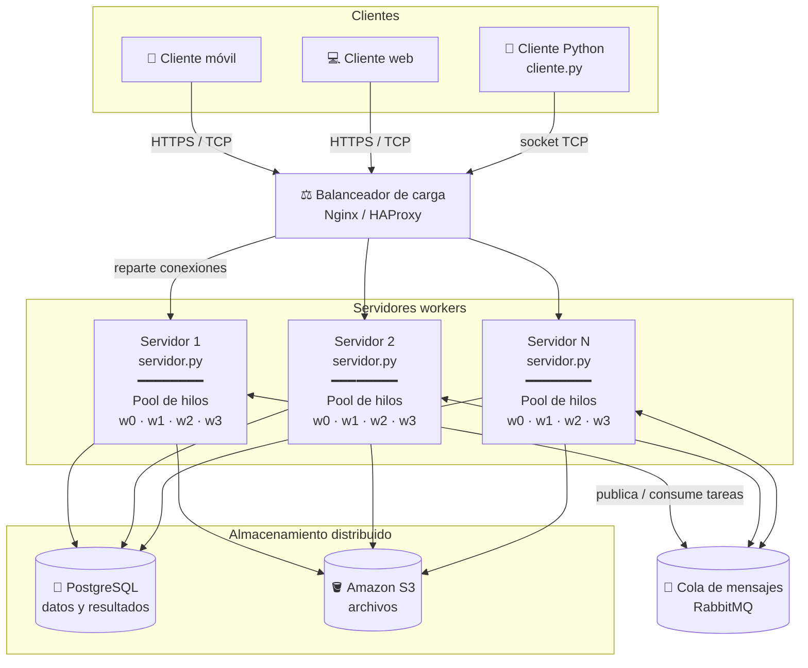

# PFO 3 - Rediseño como Sistema Distribuido (Cliente-Servidor)

Sistema de procesamiento de tareas con arquitectura cliente-servidor usando sockets TCP en Python.
El servidor recibe tareas de varios clientes y las reparte entre un pool de hilos (workers).

## Diagrama del sistema



### Flujo de una tarea

1. El **cliente** abre una conexión y envía una tarea en formato JSON.
2. El **balanceador de carga** elige uno de los servidores disponibles (por ejemplo, *round robin* o el que tenga menos conexiones).
3. El **servidor** recibe la tarea y la pasa a su **pool de hilos**; un worker libre la procesa.
4. Si la tarea es muy pesada o tiene que hacerla otro servidor, se publica en **RabbitMQ** y otro servidor la toma.
5. Los resultados se guardan en **PostgreSQL** y los archivos grandes (imágenes, reportes) en **S3**.
6. El servidor le devuelve el resultado al cliente por el mismo socket.

### Componentes

| Componente | Función | Por qué |
|---|---|---|
| Clientes (móvil, web, Python) | Envían tareas y reciben resultados | Distintos tipos de usuarios usan el mismo servicio |
| Balanceador (Nginx/HAProxy) | Reparte las conexiones entre servidores | Si un servidor se cae o se satura, los demás siguen atendiendo |
| Servidores workers | Reciben y procesan tareas | Se pueden agregar más servidores para soportar más carga (escalado horizontal) |
| Pool de hilos | Varias tareas en paralelo dentro de un servidor | Una tarea lenta no bloquea a las demás |
| RabbitMQ | Comunicación entre servidores | Desacopla a los servidores: si uno está ocupado, la tarea espera en la cola sin perderse |
| PostgreSQL | Datos estructurados (usuarios, tareas, resultados) | Base de datos relacional confiable con transacciones |
| S3 | Archivos grandes | Almacenamiento de objetos barato y replicado |

## Implementación

En este repositorio está implementada la parte central del diagrama: **cliente** y **servidor con pool de workers** comunicándose por sockets TCP.

| Archivo | Descripción |
|---|---|
| `servidor.py` | Escucha conexiones, recibe tareas y las distribuye a un `ThreadPoolExecutor` |
| `cliente.py` | Se conecta, envía tareas y muestra los resultados |

### Protocolo

Cada mensaje es un objeto JSON en una línea, terminado en `\n`.

Pedido del cliente:
```json
{"id": 1, "tipo": "sumar", "datos": [10, 20, 30]}
```

Respuesta del servidor:
```json
{"id": 1, "estado": "ok", "resultado": 60, "worker": "worker_2", "duracion_ms": 0.01}
```

El `id` permite al cliente saber a qué tarea corresponde cada respuesta, ya que **las respuestas llegan en el orden en que terminan**, no en el orden en que se enviaron.

### Tareas disponibles

| Tipo | Datos | Ejemplo de resultado |
|---|---|---|
| `sumar` | lista de números | `[1, 2, 3]` → `6` |
| `multiplicar` | lista de números | `[2, 3, 4]` → `24` |
| `factorial` | entero ≥ 0 | `5` → `120` |
| `es_primo` | entero | `97` → `true` |
| `invertir` | texto | `"hola"` → `"aloh"` |
| `contar_palabras` | texto | `"hola mundo"` → `2` |
| `esperar` | segundos (0 a 30) | simula una tarea pesada |

## Cómo ejecutarlo

Requiere Python 3.9 o superior. No usa librerías externas.

**1. Iniciar el servidor** (en una terminal):
```bash
python servidor.py
```
Opciones: `--host`, `--puerto` (por defecto 5000), `--workers` (por defecto 4).

**2. Ejecutar el cliente** (en otra terminal):
```bash
python cliente.py
```
Envía un lote de tareas de ejemplo y muestra los resultados.

Modo interactivo para escribir tareas a mano:
```bash
python cliente.py --interactivo
> sumar [1, 2, 3]
> factorial 6
> invertir "hola mundo"
> salir
```

Para conectarse a un servidor en otra computadora:
```bash
python cliente.py --host 192.168.0.10 --puerto 5000
```

### Ejemplo de salida

```
Enviando 9 tareas al servidor...

  -> tarea 1: esperar 2
  -> tarea 2: sumar [10, 20, 30]
  ...

Resultados (llegan en el orden en que terminan):

  <- tarea 2: 60 (resuelta por worker_1, 0.01 ms)
  <- tarea 3: 24 (resuelta por worker_1, 0.02 ms)
  <- tarea 4: 3628800 (resuelta por worker_2, 0.01 ms)
  ...
  <- tarea 8: espere 1.0 segundos (resuelta por worker_1, 1000.63 ms)
  <- tarea 1: espere 2.0 segundos (resuelta por worker_0, 2000.46 ms)
```

La tarea 1 se envió primero pero termina última porque tarda 2 segundos. Mientras tanto, los otros workers resolvieron el resto: eso muestra que el pool de hilos trabaja en paralelo.
